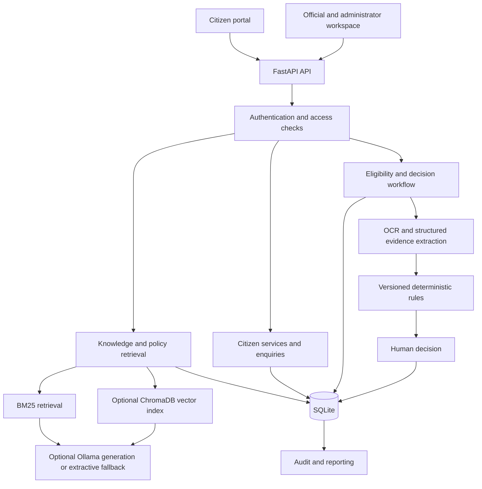

# GovIntel AI

**Government Intelligence & Service Delivery Platform**

*Intelligent government. Informed decisions. Better public services.*

GovIntel AI is a modular, AI-assisted government service delivery prototype developed for the SITA InnovAIte 2026 Hackathon. It brings citizen services, government knowledge and policy assistance, and grant and benefits eligibility assessment into a unified web application. The platform builds on GovAssist, with an integrated FastAPI backend and a redesigned HTML/CSS/JavaScript interface.

> **Prototype notice:** This is a demonstration, not an official government service or a production-ready system. Use only public or synthetic, non-personal demonstration data. All bundled policy thresholds and application records are fictional. AI recommendations do not constitute official decisions. The project is designed to address both hackathon challenge statements; submission under both categories is subject to the organisers' rules.

## Contents

- [Problem statement](#problem-statement)
- [Objectives](#objectives)
- [Platform modules](#platform-modules)
- [Challenge alignment](#challenge-alignment)
- [Architecture and technology](#architecture-and-technology)
- [Installation](#installation)
- [AI and OCR configuration](#ai-and-ocr-configuration)
- [Demo accounts](#demo-accounts)
- [Live demo walkthrough](#live-demo-walkthrough)
- [API overview](#api-overview)
- [Project structure](#project-structure)
- [Testing](#testing)
- [Security, privacy and responsible AI](#security-privacy-and-responsible-ai)
- [Limitations and production roadmap](#limitations-and-production-roadmap)
- [Contributing](#contributing)

## Problem statement

Government information is often distributed across multiple repositories, policies and service channels. Officials may spend considerable time locating current guidance and reviewing supporting evidence, while citizens may struggle to find relevant services or follow the progress of their enquiries. Manual eligibility checks can also produce inconsistent recommendations and increase administrative workload.

GovIntel AI explores how source-grounded AI, document processing, configurable rules and human review can support these workflows without transferring decision-making authority to an AI model.

## Objectives

- Make government service information easier to find and understand.
- Assist officials with locating and verifying relevant policies and their versions.
- Reduce repetitive document checks through OCR and structured extraction.
- Apply approved eligibility criteria consistently and explain individual rule outcomes.
- Keep authorised officials responsible for final decisions.
- Preserve traceability of source documents, assessment snapshots and decisions.
- Provide a modular foundation for a controlled government pilot.

## Platform modules

### 1. Citizen Services

- Public, source-grounded citizen assistant and government services directory.
- Citizen enquiry submission, reference-based tracking and staff status updates.
- Assisted departmental classification and routing.
- Language options for AI responses; translation quality depends on the available model.

### 2. Government Knowledge & Policy Assistant (Challenge 2)

- Staff-only conversational policy workspace with basic follow-up context.
- BM25 retrieval and optional vector retrieval using ChromaDB and Ollama embeddings.
- Source references with document metadata, section/page information and version.
- Source viewer displaying extracted text for verification.
- Public, Internal and Restricted classification with role-based retrieval filtering.
- Current and superseded policy versions, historical search and policy comparison.
- Ingestion of PDF, DOCX, TXT, Markdown, saved HTML and supported scanned images.
- Simulated SharePoint and DMS repositories, alongside the public library.
- Refusal when there is insufficient authorised evidence or a detected unsafe instruction.

### 3. Grant & Benefits Eligibility Assistant (Challenge 1)

- Configurable demonstration programmes: Housing Support, Study Bursary and Social Support.
- Staff-created synthetic applications and supporting evidence uploads.
- Tesseract OCR for images/scanned PDFs; text extraction for readable PDFs and TXT.
- Extraction of demonstration age, income and residence fields.
- Version-controlled programme rules and template-based draft rule extraction from sample policies.
- Deterministic eligibility checks, document completeness and declared/extracted data consistency checks.
- Recommendations: **Likely eligible**, **Not eligible** or **Needs review**.
- Evidence-quality confidence heuristic, individual rule explanations and assessment snapshots.
- Authenticated official approval, decline or request for more information, with a recorded reason.
- No automatic application rejection.

### 4. Administration, Security & Governance

- Unified staff dashboard, operational statistics and enquiry management.
- Administrator document ingestion, metadata maintenance and eligibility-rule management.
- Seeded user account overview (read-only in the current demo).
- Password hashing, signed authentication tokens and server-side role checks.
- Audit events and decision history; audit records are not tamper-proof.
- Foundational privacy controls and a roadmap for enterprise security and governance.

## Challenge alignment

| SITA challenge | Demonstration |
| --- | --- |
| Grant & Benefits Eligibility Assistant | Synthetic application → document extraction → versioned rules → explained recommendation → official decision → audit trail |
| Government Knowledge & Policy Assistant | Document ingestion → authorised retrieval → source-grounded answer → source verification; insufficient-evidence refusal |

The integrated use case is a fictional housing support programme. Officials can find the relevant policy, check its current version, apply its approved demonstration criteria to evidence and record an accountable decision. The policy assistant provides information; it does not decide eligibility. The eligibility rules are deterministic rather than free-form LLM judgments.

The prototype demonstrates the central workflows of both challenges, not complete production compliance with every requirement. The formal proposal and architecture/pilot documentation can accompany the submission separately.

## Architecture and technology



| Layer | Technology |
| --- | --- |
| Interface | HTML5, CSS3, JavaScript |
| Backend / API | Python, FastAPI, Uvicorn, Pydantic |
| Database | SQLite |
| Retrieval | BM25; optional ChromaDB |
| Local AI runtime | Ollama |
| Default generation model | `llama3.2:3b` |
| Optional embedding model | `bge-m3` |
| PDF / Word / HTML processing | PyMuPDF, python-docx, Beautiful Soup |
| OCR | Tesseract, pytesseract, Pillow |
| Tests | pytest, HTTPX |
| Deployment | Local Python launcher or Docker Compose |

The FastAPI service serves the frontend and API on the same local port. The retrieval layer filters authorised documents before sending retrieved passages to the optional local model. The legacy GovAssist/Streamlit code is preserved in `legacy/` for reference; it is not the active application.

The prototype uses locally runnable tools. AI model and dependency licences must be reviewed individually for any future distribution or government deployment. Llama 3.2 uses its own community licence; it should not be represented as an OSI-approved open-source model. Confirm model licensing eligibility against the hackathon's open-source tools rule.

## Installation

### Prerequisites

- Python 3.11 or 3.12 recommended, with Python available on PATH.
- Git, if cloning the repository.
- Internet access for first-time dependency/model downloads.
- Optional: Ollama for generative AI and Tesseract for scanned documents.

### Clone the repository

```bash
git clone https://github.com/Shadrack1989/-GovIntel-AI.git
cd ./-GovIntel-AI
```

Run the following from the project root, where `run.py` and `requirements.txt` are located.

### Windows (recommended for the demonstration)

Double-click `start_windows.bat`. It creates `.venv`, installs dependencies on first run and starts the server. If you already have a virtual environment, manually refresh the dependencies after code changes.

Alternatively, in VS Code PowerShell:

```powershell
py -3 -m venv .venv
.\.venv\Scripts\python.exe -m pip install -r requirements.txt
.\.venv\Scripts\python.exe run.py
```

### Linux / macOS

```bash
python3 -m venv .venv
source .venv/bin/activate
python -m pip install -r requirements.txt
python run.py
```

### Docker Compose

```bash
docker compose up --build
```

Docker includes Tesseract and a separate Ollama service. Pull the generation model if you want generative answers:

```bash
docker compose exec ollama ollama pull llama3.2:3b
```

Stop using `docker compose down`. The named data volume persists across restarts. Do not delete volumes unless intentionally resetting the demo.

### Local endpoints

| Resource | URL |
| --- | --- |
| GovIntel AI | http://localhost:8000 |
| Interactive API documentation | http://localhost:8000/docs |
| OpenAPI schema | http://localhost:8000/openapi.json |
| Health check | http://localhost:8000/api/health |

On first launch, the local database is initialised and seeded automatically. The default Python launcher binds to `127.0.0.1`. The Docker Compose port is also bound to localhost. Keep this demo local.

### Reset local demo data

Stop the application and delete `data/govassist.db` (and `data/chroma/` if using the optional index), then restart. **This permanently removes local changes and recreates demonstration records.** Do not copy an old GovAssist database into the new prototype. Docker uses a separate named data volume.

## AI and OCR configuration

### Generative AI with Ollama

Install Ollama from <https://ollama.com/> and make sure its local service is running. Download the configured model:

```bash
ollama pull llama3.2:3b
```

The app defaults to `USE_OLLAMA=auto`. Without Ollama, the app uses an explicitly labelled extractive fallback based on retrieved passages. This is **not** generative AI. Test both modes before the presentation. Model speed and memory requirements depend on the machine.

### Optional semantic vector retrieval

BM25 works without a vector database. For optional ChromaDB retrieval:

```bash
python -m pip install chromadb
ollama pull bge-m3
```

Set `USE_CHROMA=on` in your process environment before launch. For an existing local database, rebuild the optional dense index using the same environment and interpreter:

```bash
python -c "from backend.retrieval import reindex_dense; print(reindex_dense())"
```

The default Docker image does not install ChromaDB. Extend it if required. Ollama and ChromaDB integration need verification on the actual demo hardware.

### OCR

Install the Tesseract executable separately from the Python packages. See <https://tesseract-ocr.github.io/tessdoc/Installation.html>.

- Windows: the app checks `C:\Program Files\Tesseract-OCR\tesseract.exe`; otherwise add Tesseract to PATH or set `TESSERACT_CMD`.
- Ubuntu/Debian: `sudo apt install tesseract-ocr`.
- Docker: Tesseract is already installed in the supplied image.

Check `tesseract --version` if installed on PATH. OCR is needed for the bundled PNG sample evidence and image-only PDFs. Text-based PDF/TXT processing can operate without OCR.

### Environment configuration

`.env.example` lists common settings. The current backend uses `os.getenv`; it does **not** automatically load a `.env` file. Set variables in your shell or deployment environment before starting the app. For example, PowerShell:

```powershell
$env:USE_OLLAMA = "auto"
$env:USE_CHROMA = "off"
.\.venv\Scripts\python.exe run.py
```

| Variable | Default / purpose |
| --- | --- |
| `GOVASSIST_SECRET` | Random per process if unset; set a strong secret for stable signed tokens |
| `GOVASSIST_DATA_DIR` | `data/` |
| `GOVASSIST_DB` | `data/govassist.db` |
| `OLLAMA_URL` | `http://localhost:11434` |
| `OLLAMA_MODEL` | `llama3.2:3b` |
| `OLLAMA_EMBED_MODEL` | `bge-m3` |
| `USE_OLLAMA` | `auto` (`on`, `off` also supported) |
| `USE_CHROMA` | `off` |
| `TESSERACT_CMD` | Optional executable path |
| `DEMO_STAFF_PASSWORD` | Demo seed password override |
| `DEMO_ADMIN_PASSWORD` | Demo seed password override |
| `TOKEN_TTL_SECONDS` | 28800 (8 hours) |
| `MAX_UPLOAD_BYTES` | 5242880 (5 MiB) |
| `HOST` | `127.0.0.1` |
| `API_PORT` | `8000` |
| `NO_BROWSER` | Set to `1` to disable automatic browser opening |

Seed password overrides apply when the demo accounts are first created; they are not a password rotation mechanism for an existing database. Some names retain the `GOVASSIST_` prefix for compatibility.

## Demo accounts

Credentials are provided in `DEMO LOGINS.txt` and in the interface's demo login helper. They are intentionally insecure test accounts for a local-only demo, not real user accounts. Do not use the same credentials in a shared deployment.

| Role | Access |
| --- | --- |
| Citizen | No login; public services and public knowledge |
| Government official (staff) | Public/Internal policy content, enquiries, assessments and decisions |
| Administrator / policy owner | Staff capabilities plus Restricted demo documents, document metadata and eligibility-rule configuration |

The current authentication scope is role-based and system-wide, not per department. A production release must remove default accounts and the demo login helper and replace them with approved identity management.

## Live demo walkthrough

A five-minute pitch can use the following sequence. All cases and policy values are fictional.

1. **Citizen portal:** ask about replacing a lost ID, inspect citations and show the services directory or enquiry tracking.
2. **Knowledge and policy:** sign in as staff. Ask `What is the maximum monthly income for Housing Support?` The seeded active fictional policy states R3500. Open the source and its clause/version. Ask `What is the capital of France?` to test the insufficient-evidence response.
3. **Eligibility:** open the pre-assessed case `GI-DEMO-002`. Show the declared/extracted income mismatch, individual rule outcomes, confidence heuristic and `Needs review` recommendation.
4. **Human decision:** record a request for more information with a reason; inspect the decision history and audit trail. No automatic rejection occurs.
5. **Governance:** as administrator, demonstrate the simulated repositories, compare current and superseded policies, or show the rule editor. Explain the pilot and enterprise security roadmap.

### Seeded assessment cases

| Reference | Expected initial recommendation |
| --- | --- |
| `GI-DEMO-001` | Likely eligible |
| `GI-DEMO-002` | Needs review — declared/extracted income mismatch |
| `GI-DEMO-003` | Not eligible — fictional income threshold exceeded |
| `GI-DEMO-004` | Needs review — missing residence evidence |

### Optional full OCR demonstration

Create a fictional applicant in Housing Support with age 30 and declared monthly income R2800. Upload `web/samples/identity.png`, `payslip.png` and `residence.png` using the matching evidence types. Run the assessment. Upload `payslip_mismatch.txt` as payslip evidence and rerun to show an inconsistency. Record a human decision with a reason. The samples deliberately use simple layouts; extraction from arbitrary documents is not guaranteed.

### Access-control demonstration

Staff can retrieve the synthetic Operations Review Handbook (Internal) but must not retrieve the Restricted Pilot Control Note. Administrators may access that restricted synthetic document. Public citizens may only retrieve active Public documents. All classification examples are simulated; never upload actual classified records.

## API overview

The interactive OpenAPI documentation contains payload schemas and the full route list. Selected endpoints:

| Method | Endpoint | Purpose |
| --- | --- | --- |
| GET | `/api/health` | Health and retrieval mode |
| POST | `/api/auth/login` | Staff/admin authentication |
| GET | `/api/services` | Public service directory |
| POST | `/api/chat` | Public assistant |
| POST | `/api/enquiries` | Create enquiry |
| GET | `/api/enquiries/track/{reference}` | Track enquiry |
| GET | `/api/enquiries` | Staff enquiry list |
| PATCH | `/api/enquiries/{eid}` | Staff enquiry update |
| GET | `/api/documents` | Authorised document list |
| POST | `/api/documents/upload` | Upload document |
| POST | `/api/intel/policy/chat` | Staff policy assistant |
| GET | `/api/intel/source/{i}` | Authorised source viewer data |
| GET | `/api/intel/programmes` | Benefit programmes |
| POST | `/api/intel/programmes/{i}/rules` | Admin rule version creation |
| GET / POST | `/api/intel/applications` | List/create synthetic applications |
| POST | `/api/intel/applications/{i}/evidence` | Upload and extract evidence |
| POST | `/api/intel/applications/{i}/assess` | Run assessment |
| POST | `/api/intel/applications/{i}/decision` | Record official decision |
| GET | `/api/intel/overview` | Platform overview |
| GET | `/api/audit` | Audit events |

Protected routes require a valid bearer token and appropriate role. Refer to `/docs` for request schemas and access errors.

## Project structure

```text
GovIntelAI/
├── backend/
│   ├── main.py           # FastAPI application and citizen endpoints
│   ├── govintel.py       # Policy, eligibility and decision endpoints
│   ├── config.py         # Environment settings and demo users
│   ├── db.py             # SQLite schema and helpers
│   ├── retrieval.py      # Ingestion, BM25 and optional vector index
│   ├── llm.py            # Ollama interface
│   ├── security.py       # Password and token handling, role checks
│   ├── routing.py        # Enquiry classification/routing
│   ├── seed.py           # Initial public data and accounts
│   └── textutil.py       # Text processing
├── web/
│   ├── index.html        # Application entry point
│   ├── app.js            # Frontend screens and API calls
│   ├── style.css         # GovIntel AI design system
│   └── samples/          # Synthetic evidence for OCR demo
├── data/
│   ├── docs/            # Synthetic knowledge guides
│   └── services.json    # Seed service directory
├── tests/               # API and integrated workflow tests
├── legacy/              # Original GovAssist code, not executed
├── run.py               # Local launcher
├── start_windows.bat    # Windows setup and launch
├── requirements.txt     # Python dependencies
├── Dockerfile
├── docker-compose.yml
├── .env.example
├── .gitignore
├── DEMO LOGINS.txt
└── README.md
```

Runtime SQLite data, virtual environments, local secrets and vector indexes must not be committed.

## Testing

From the project root with dependencies installed:

```bash
python -m pytest -q
```

On Windows without activating the virtual environment:

```powershell
.\.venv\Scripts\python.exe -m pytest -q
```

The previous prototype build reported **15 passing backend tests**, covering citizen workflows, authentication and token tampering, policy access/currency, document uploads, rule versioning, an integrated eligibility workflow and real OCR when available. The tests have not been rerun for this README-only revision. Tesseract must be installed to exercise real OCR; review the test output for skips. JavaScript syntax and selected interface screens were checked during the prototype build. Full UI click-through, the Windows launcher and real Ollama/Chroma integration still need local validation.

## Security, privacy and responsible AI

### Current prototype controls

- Password hashing, signed bearer tokens, role checks and a limited in-memory request rate limiter.
- Role-filtered document retrieval and source access.
- Upload size/type checks and basic prompt-injection detection.
- Synthetic data policy; no live personal information or classified government documents permitted.
- Evidence-based rule explanations, version references, low-confidence escalation and refusal when evidence is insufficient.
- Human decision required, including recorded reasons.
- Audit events and historical assessment snapshots.

### Governance design objectives

The platform is intended to support privacy and security principles associated with POPIA, PAIA, PAJA and MISS, including minimisation, authorised access, explainability, human accountability and appropriate document classification. These are design objectives, not a certification or legal finding of compliance. Access to information and privacy obligations must be reconciled through approved departmental processes.

### Planned pilot/production controls (not implemented in this demo)

- Multi-factor authentication (MFA), enterprise SSO and government identity integration.
- Department-level entitlements and centrally managed user lifecycle.
- Encryption in transit and at rest, secure key/secret management and protected document storage.
- Formal privacy notices, lawful processing controls, retention/deletion workflows, data subject request handling and incident response.
- Malware scanning, stronger upload isolation, distributed rate limiting and security monitoring.
- Tamper-evident audit storage, backup and disaster recovery, independent security testing and fairness/accuracy evaluation.

Do not expose the prototype to the public internet or process real applications. Do not commit actual passwords, access tokens, personal data, database exports or restricted challenge documents. The bundled demo credentials are test fixtures only. No live government integrations or real identity/income checks are implemented.

## Limitations and production roadmap

| Area | Current limitation / future direction |
| --- | --- |
| Corpus | Synthetic guides and fictional policies; replace with approved, versioned authoritative sources during a controlled pilot |
| Retrieval and citations | BM25 default, optional vector search; extracted text viewer, not original binary rendering; evaluate grounding and citation accuracy |
| Rules | Template-based age/income/document criteria; policy owners must verify and approve mappings; expand rule language and tests |
| OCR | Simple synthetic document layouts; add verified extraction, manual corrections and robust confidence calibration |
| Confidence | Evidence-quality heuristic, not a calibrated probability of eligibility |
| Access | System-wide roles; add department/programme permissions, MFA and SSO |
| Data | SQLite for demo; plan PostgreSQL and encrypted document storage |
| Repositories | Simulated SharePoint/DMS and saved HTML upload; no live connectors |
| Audit | Local records, not immutable; implement tamper-evident and privacy-aware audit retention |
| AI | Ollama optional; fallback is extractive; validate accuracy, multilingual performance, bias and injection resistance |

### Phased implementation

1. **Hackathon prototype:** demonstrate both workflows with synthetic data, foundational security and a five-minute pitch.
2. **Controlled pilot:** validate scope with policy owners; implement identity, privacy and department controls; evaluate one programme and approved test corpus.
3. **Production readiness:** strengthen infrastructure, monitoring, integration, testing, backup and formal compliance assessment.
4. **Departmental rollout:** expand only after pilot approval, training and operational readiness reviews.

Potential pilot indicators include policy search time, citation correctness, document extraction accuracy, application review time, rule consistency, human override rates and access-control failures. No savings or performance improvements have been measured by the demo.

## Contributing

Collaborators should use feature branches and pull requests when working concurrently, unless the team agrees on direct commits to the main branch. Run the tests before submitting changes, document configuration changes and review for secrets or personal information.

```bash
git checkout -b feature/your-change
# Edit and test the project.
git add .
git commit -m "Describe your change"
git push -u origin feature/your-change
```

Open a pull request into the repository's default branch. Do not force-push shared history. Contributors should agree on licence and attribution before public distribution; no project licence is asserted by this README.

---

**GovIntel AI — Government Intelligence & Service Delivery Platform**  
SITA InnovAIte 2026 Hackathon prototype. Not an official government service.
